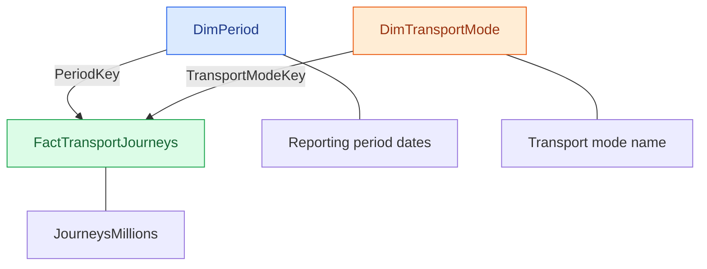

# London Transport Data Warehouse

## Project Overview

This project demonstrates the design and implementation of a relational data warehouse using Microsoft SQL Server and London transport journey data.

The warehouse organises transport journey records into staging, dimension and fact tables to support structured querying, data quality checks and transport analysis.

## Objectives

- Prepare transport data for warehouse loading.
- Design a staging layer and dimensional warehouse structure.
- Organise reporting periods and transport modes into dimension tables.
- Store transport journey measures in a fact table.
- Perform data quality checks and validate warehouse records.
- Use SQL queries to explore transport journey data.

## Tools and Technologies

- Microsoft SQL Server
- SQL Server Management Studio (SSMS)
- SQL
- Python and Pandas for data preparation

## Data Warehouse Design

The project uses four main tables:

| Table | Purpose |
|---|---|
| `StgTransportJourneys` | Holds transport journey data before warehouse loading. |
| `DimPeriod` | Stores reporting-period information, including beginning and ending dates. |
| `DimTransportMode` | Stores the available transport modes. |
| `FactTransportJourneys` | Stores journey measures linked to period and transport-mode dimensions. |

The fact table connects to the dimension tables through their respective keys.

### Data Warehouse Schema

## Data Quality and Validation

The project includes SQL scripts for data quality checks and warehouse validation.

Previous validation results included:

- 1,491 staging records
- 1,491 fact records
- 213 reporting periods
- 7 transport modes
- 102 missing journey values identified for review

These figures reflect previous validation runs and should be rechecked against the final database before publication.

## SQL Scripts

The `sql` folder contains scripts for:

- Creating the staging table
- Creating the warehouse structure
- Loading dimension tables
- Loading fact records
- Performing data quality checks
- Validating the warehouse
- Analysing transport journey data

## Key Learning Outcomes

This project provided practical experience with relational database design, dimensional modelling, fact and dimension tables, SQL data loading, data quality validation and analytical querying.

## Project Status

The SQL Server warehouse structure and initial data loading have been implemented. Python pipeline automation remains unfinished and is not presented as a completed feature.

## Future Improvements

- Complete and test automated Python ETL.
- Strengthen repeat-load validation.
- Expand transport analysis and reporting.
